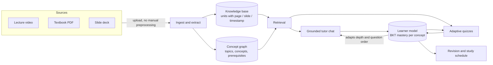
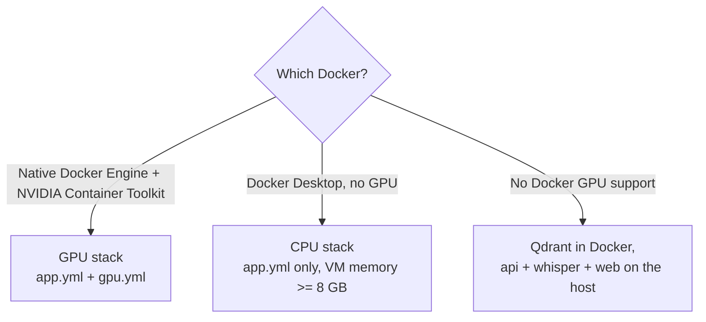
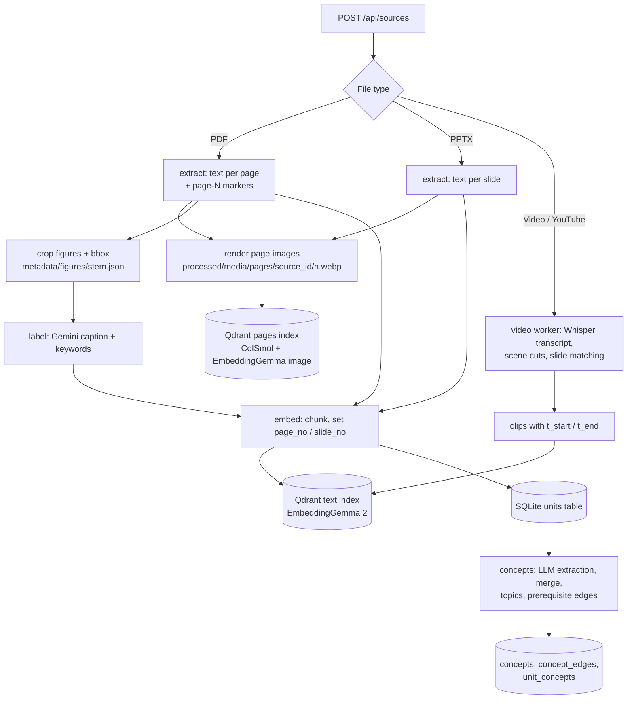
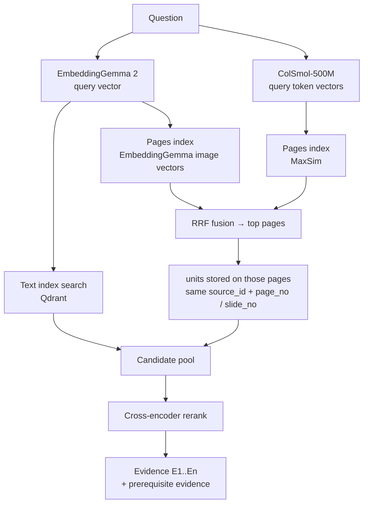
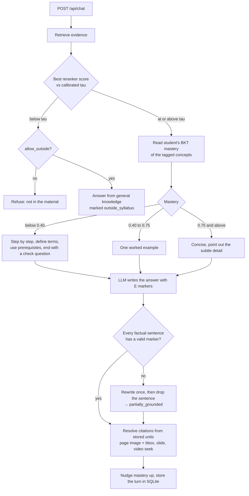
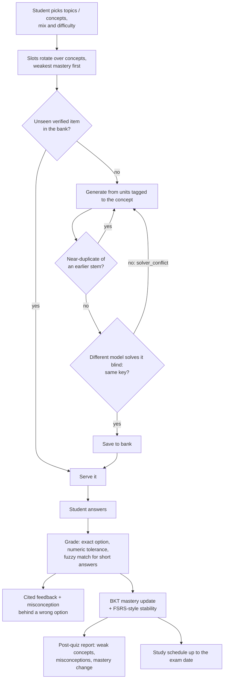
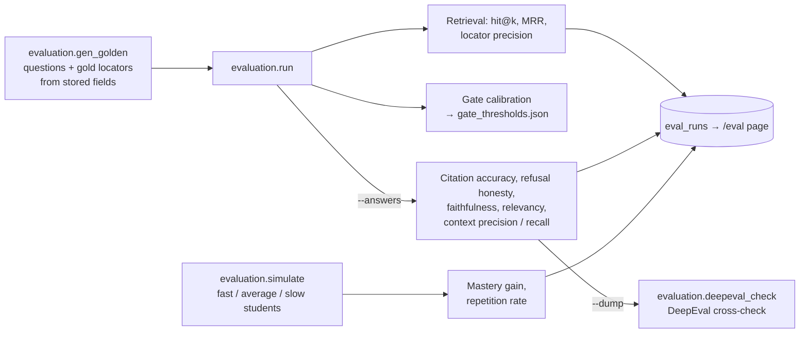

# Loopers — Multimodal AI Study Companion

Track D · Personalized Tutoring & Adaptive Learning · Multimodal AI Hackathon 2026

Loopers turns **lecture videos, textbooks and slide decks** into one source-cited knowledge base. A tutor answers
from that material only and cites the exact page, slide or video second. Adaptive quizzes are verified before
they are served, and a learner model tracks mastery per concept.

## Contents

- [How it works](#how-it-works)
- [Quickstart](#quickstart)
- [Run with Docker](#run-with-docker)
- [Ingestion and the knowledge base](#ingestion-and-the-knowledge-base)
- [Retrieval](#retrieval)
- [Grounded tutor chat](#grounded-tutor-chat)
- [Assessment and the learner model](#assessment-and-the-learner-model)
- [Web app](#web-app)
- [Evaluation](#evaluation)
- [Testing](#testing)
- [Corpus](#corpus)
- [Status and results](#status-and-results)
- [Repo layout](#repo-layout)

## How it works



Every piece of content is a *unit* with a stored locator. The language model never writes a page number or
timestamp; it writes evidence markers like `[E1]`, and the server resolves them from stored fields.

## Quickstart

```bash
cd RAG_DB
python src/pipeline.py ingest
python src/pipeline.py extract
python src/pipeline.py label     # needs GEMINI_API_KEY
python src/pipeline.py embed
python src/pipeline.py eval --k 5
cd src && LOOPERS_NO_REEXEC=1 uvicorn api.main:app   # API at http://localhost:8000
cd frontend && npm run dev                           # UI at http://localhost:3000
```

Run uvicorn without `--reload`: a reload orphans a running ingest job.

## Run with Docker

Copy the env file and add the LLM keys first:

```bash
cp RAG_DB/.env.example RAG_DB/.env
```



**GPU stack** (recommended, used for the demo):

```bash
docker compose -f docker-compose.app.yml -f docker-compose.gpu.yml --profile asr up -d --build
```

**CPU stack:**

```bash
docker compose -f docker-compose.app.yml up -d --build              # UI :3000, API :8000
docker compose -f docker-compose.app.yml --profile asr up -d        # adds the whisper server
```

Docker Desktop runs containers in a VM with no GPU. Give that VM at least 8 GB of memory (Settings → Resources).
At about 3.5 GB the `embed` stage is killed with `exited with code -9`, and the UI shows "Failed to fetch" while
the api restarts.

**Host mode** (qdrant in Docker, everything else on the host GPU through the `.venv` CUDA build of torch):

```bash
docker compose -f docker-compose.app.yml up -d qdrant
cd RAG_DB/src && QDRANT_URL=http://localhost:6333 LOOPERS_NO_REEXEC=1 uvicorn api.main:app --port 8000
python whisper-server/server.py --port 8300      # large-v3-turbo, float16 on the GPU
cd frontend && npm run dev                       # UI :3000, proxies /api to localhost:8000
```

**Everyday commands:**

```bash
docker compose -f docker-compose.app.yml logs -f api                               # tail the api
docker compose -f docker-compose.app.yml run --rm api python src/pipeline.py embed # re-embed
docker compose -f docker-compose.app.yml down                                      # stop; volumes keep the data
```

### GPU memory on a 6 GB card

| Model | Where it runs |
|---|---|
| EmbeddingGemma 2 (text, image, video and audio embeddings) | GPU, resident in the api |
| Cross-encoder reranker (`bge-reranker-v2-m3`) | CPU memory; moves to the GPU only while it scores (`RERANK_KEEP_ON_GPU=1` keeps it there) |
| ColSmol-500M (page-image retrieval) | CPU memory; moves to the GPU only while it encodes |
| Whisper large-v3-turbo | CPU int8 by default |

`WHISPER_DEVICE=cuda WHISPER_COMPUTE_TYPE=int8_float16` also fits (about 1 GB) and transcribes a 52-minute
lecture in about a minute. On 8 GB or more use `WHISPER_COMPUTE_TYPE=float16`. Lecture clips are embedded one
at a time; a clip that still runs out of GPU memory is embedded from its transcript and audio only.

Do not run `evaluation.run` while the api is answering chats on a 6 GB card. Both load the embedder and the
reranker, and the run stops rather than score on a fallback. If port 8000 or 3000 is taken, set `API_PORT` and
`WEB_PORT`.

## Ingestion and the knowledge base



**Locators.** `extract` writes a `<!-- page N -->` marker before each page, and `embed` turns the markers into
`page_no` or `slide_no`. Ingestion fails if a PDF chunk ends up without one. Units live in the SQLite `units`
table and in the Qdrant payload, keyed by `source_id`: the first 16 hex characters of the file's sha256, the
same id `POST /api/sources` returns. Page images are served at `/media/pages/...`.

**Figures.** Photos come from the PDF's embedded images. Graphs and diagrams are usually drawn as vector paths,
so they are found through their "Figure N.M" caption. The page and bounding box of each crop (in page-image
pixels) go into `metadata/figures/<stem>.json`, and `label` copies them into the figure's unit so a citation
can draw the box on the page image. EmbeddingGemma 2 embeds each figure's picture together with its caption.

**Concept graph.** `python src/pipeline.py concepts` extracts concepts with an LLM, merges near-duplicates by
embedding distance, groups them under topics, scores prerequisite edges and removes cycles. Every unit is
tagged with its concepts. Without an LLM key the stage is skipped and the API serves the fixture graph.
`GET /api/graph` and `GET /api/concepts/{id}` read the stored graph.

**Hidden sources.** A source with `sources.hidden = 1` drops out of `GET /api/sources`, tutor retrieval and
`evaluation.run --indexed-only`. Its units, quiz items and old citations still resolve. Re-uploading the same
file reuses the stored copy and keeps the first title.

## Retrieval



The text leg finds chunks, figure captions and video clips. The **page-image leg** finds whole pages by how
they look, which catches plots, tables and equations that text extraction misses. It is ColPali-style late
interaction: ColSmol-500M (`vidore/colSmol-500M`) keeps one vector per image patch and scores a page by
MaxSim against the query's token vectors. The same page images are also embedded by EmbeddingGemma 2, which
is multimodal, so its image vectors share a space with the text query vector. Qdrant fuses the two page
rankings with RRF.

A page hit only names a page. The leg then pulls the units already stored for that page and adds them to the
reranker's pool, so citations still come from stored locators.

The page leg is off by default. Turn it on with `LOOPERS_VISUAL_RETRIEVAL=1`, then index the rendered pages:

```bash
LOOPERS_VISUAL_RETRIEVAL=1 docker compose -f docker-compose.app.yml -f docker-compose.gpu.yml up -d --build api
docker compose -f docker-compose.app.yml -f docker-compose.gpu.yml exec api sh -c "cd src && python -m ingest.page_embed"
```

With the flag on, `pipeline.py embed` indexes new pages at the end of every run. `COLPALI_MODEL` swaps the
model (for example `vidore/colqwen2-v1.0` on a card with 8 GB or more).

## Grounded tutor chat



Sessions and turns are stored in SQLite, so two sessions never share history. Thresholds come from
`metadata/gate_thresholds.json` (written by calibration), or placeholders before the first run. Without an
LLM key the chat endpoint quotes the best evidence with its markers instead of generating text.

## Assessment and the learner model



**Endpoints.**

- `POST /api/quiz/generate` writes one item (multiple choice, short answer or numeric).
- `POST /api/quizzes` builds a practice quiz or a timed mock exam (`mode: "mock"`, 90 s per item). It takes a
  mix such as `{"mcq": 4, "short": 2, "numeric": 2}` and an optional target difficulty (IRT b).
- `POST /api/quizzes/{id}/answers` grades a batch and returns correctness, the cited explanation, the
  misconception behind a wrong option and the mastery updates.
- `GET /api/quizzes/{id}/report` returns the post-assessment report.
- `GET /api/students/{id}/schedule` plans study days up to the exam date.

Every served item carries its topic, concept, Bloom level, difficulty label and source locations. The
generator is told which questions were already asked, and the answer key never leaves the server until the
student submits.

**Learner model.** Mastery is a Bayesian knowledge tracing estimate per concept: slip 0.10, guess 0.20, learn
0.05 per answered item and 0.02 per grounded chat turn. Each answer also updates an FSRS-style stability that
sets the next review date. The schedule puts weak or overdue concepts first, unlocks a concept once its
prerequisites reach 0.70, and caps each day at `minutes_per_day`.

**New students.** An intake question (the student's background sets the prior ability and starting mastery) is
followed by a diagnostic of up to five verified multiple-choice items, scored with a one-parameter IRT model.

## Web app

The Next.js app in `frontend/` proxies `/api` and `/media` to the API.

| Page | What it does |
|---|---|
| **Chat** (`/`) | Grounded tutor with a topic picker. Citation chips open the page image with its box, the slide, or the lecture video at the cited second. "Course map" opens the prerequisite graph; the side panel uploads PDFs, decks, videos or a YouTube link and shows job progress. |
| **Quiz** (`/quiz`) | Topic cards, question count, practice or timed mock, multiple choice or mixed. Feedback after each answer cites its sources. |
| **Report** (`/report`) | Every attempt in this browser (answers pie, score per attempt, mastery by topic). `/report?quiz=<id>` shows one attempt with weak topics, misconceptions and what to study next. |
| **Dashboard** (`/dashboard`) | Mastery heatmap, weak spots, revision (flashcards and a spoken 30-second brief) and the study schedule. |
| **Evaluation** (`/eval`) | Latest golden-set and simulation runs, plus the DeepEval cross-check. |

If autoplay is blocked a "Play from mm:ss" button appears, and a browser that cannot decode H.264 gets a link
to the file. Motion uses anime.js and switches off when the operating system asks for reduced motion. Student
and session ids live in the browser's localStorage; there is no login.

## Evaluation



All of it lives in `RAG_DB/src/evaluation/` and is saved to the `eval_runs` table.

- `python -m evaluation.run --k 5 --indexed-only` scores retrieval per question type and calibrates the refusal
  gate (`--write-thresholds` writes the file). It stops if the cross-encoder fails rather than calibrate on the
  wrong score scale.
- `--answers --limit N` also answers questions through the tutor and scores them with a judge model that differs
  from the generator. `--dump file.json` saves the samples for the DeepEval cross-check, which runs in its own
  virtualenv because its dependencies conflict with the main environment.
- The DeepEval judge is Groq `gpt-oss-120b`, one parallel worker per key in `GROQ_API_KEY` (comma-separated, keys
  from separate accounts since the rate limit is per account). `DEEPEVAL_JUDGE=gemini` judges on Gemini instead.
- `python -m evaluation.golden --spotcheck` prints 20 random golden items to check by hand.
- `python -m evaluation.simulate` runs simulated students through ten sessions, adaptive versus a
  random-question control.

The golden set and the simulated students are generated, so treat the numbers as a check on the pipeline, not
as a benchmark.

## Testing

- `docs/TESTING.md` walks through every service by hand with copy-paste commands.
- `scripts/e2e_smoke.sh` runs the main path end to end against a running API (`SMOKE_VIDEO` adds a lecture
  video).
- Backend unit tests: `cd RAG_DB && python -m pytest tests -q`.

## Corpus

The demo course is *Limits and Continuity* in all three modalities, uploaded through `POST /api/sources` with no
manual preprocessing:

| Modality | Source | Licence |
|---|---|---|
| Textbook | OpenStax *Calculus Volume 1*, Chapter 2 through section 2.4 (book pages 113–176, 64 pages). Fetched with `python src/pipeline.py download --source openstax --subjects calculus-vol1`, then cut. | CC BY-NC-SA 4.0 |
| Lecture video | MIT OCW 18.01 Single Variable Calculus, Fall 2007, Lecture 2 "Limits, Continuity; Trigonometric Limits" (52:46), https://www.youtube.com/watch?v=ryLdyDrBfvI | CC BY-NC-SA 4.0 |
| Slides | A 12-slide deck on limits and continuity written for this project, with four plotted figures | — |

None of these files are redistributed here. The pipeline is subject-agnostic; any course material works.

## Status and results

Every PS.md requirement has a working path through the API and the web app, run end to end in the Docker GPU
stack on the demo course. `scripts/e2e_smoke.sh` passes against it (last run 2026-10-12). It covers document
upload, grounded chat with a page citation and its image, refusal of an off-topic question, the concept graph, a
chat-driven mastery update, onboarding and diagnostic, a quiz round trip with cited feedback, a study schedule,
and a lecture-video citation that seeks to `#t=1873.6` with an HTTP 206 range response. Generation runs on
DeepSeek (`deepseek-flash`). The smoke-test copies of the course are hidden, so answers cite only the demo course.

### Retrieval and generation

Run `ev_4eabb66c67` on 2026-10-12 (generator DeepSeek, judge Gemini then Groq):

| Metric | Value |
|---|---|
| Golden set | 58 in-scope (34 text, 10 video, 7 multi-hop, 7 Hindi) and 20 off-material questions |
| Retrieval hit@5 / MRR | 0.97 / 0.79 (video 1.00, Hindi 1.00, multi-hop 1.00, text 0.94) |
| Refusal honesty / over-refusal | 1.00 / 0.00 (gate calibrated on current unhidden corpus: `tau` = 0.09) |
| Faithfulness / answer relevancy | 0.82 / 0.96 |
| Context precision / context recall | 0.81 / 0.78 |
| Citation accuracy | 0.48 (share of all citations that land on the single gold locator) |

DeepEval cross-check on 10 saved samples (Groq `gpt-oss-120b`, four keys in parallel, 15 minutes): faithfulness
1.00 (8 answers scored), answer relevancy 0.97 (7), context precision 0.86 (6), context recall 1.00 (7). The
remaining metric calls returned no usable verdict. DeepEval scores higher than our own judge on every metric;
with so few samples, both are reported and neither replaces the other.

### Personalization

Simulated students (60 per arm, 10 sessions of 10 items over the 43-concept graph with 18 prerequisite edges):

| Metric | Adaptive | Control |
|---|---|---|
| Mean mastery gain | 0.143 | 0.137 |
| Slow learners' gain | 0.014 | 0.006 |
| Question repetition rate | 0.002 | 0.087 |

The paired difference is 0.007 (SE 0.001), with adaptive ahead for 78% of students. On an earlier build with 40
concepts and 10 edges the difference was 0.001 (SE 0.001), which fits the gain coming mostly from prerequisite
ordering.

### Limits of these numbers

- The golden set (58 in-scope questions across text, slides, lecture video and Hindi, plus 20 off-material
  questions) was spot-checked and regenerated for the clean, unhidden demo course. It is still generated from the
  indexed units.
- The gate is calibrated and scored on the same questions, so refusal figures are optimistic.
- Citation accuracy is strict: answers usually cite several correct units while each question has one gold unit.
- The adaptive gain is small in absolute terms and depends on an assumed student model.
- The BKT estimate drifts from simulated truth over sessions (mean absolute error 0.064 after onboarding, 0.147
  after ten sessions) because fixed BKT parameters do not model forgetting. A learn rate of 0.10 or 0.15 and a
  forgetting-weighted estimate did not fix it; fitting BKT and forgetting parameters from logged attempts is
  next.

**Why one gate threshold.** A two-tier band (refuse below a low threshold, answer above a high one, entailment
check in between) was tried on the earlier corpus in run `ev_9197101682`. It did worse, with refusal honesty 0.90
at the same 0.073 over-refusal, so it was reverted. Most over-refusals then were spoken math in the lecture
transcript ("sine theta over theta"), which the cross-encoder scores low: the lecture's trigonometric-limit
passage topped out at 0.118 against the old threshold of 0.136. Recalibrated on the current corpus, the single
threshold is 0.09 with no over-refusals.

### Recently fixed

- Concept ids are derived from SHA-256 hashes (`c_*`, `t_*`), so items and mastery rows keep their concept across
  rebuilds (issues #9, #20).
- Practice quizzes and mock exams draw from a pre-generated verified item bank (`items`), which cuts serving time
  from about two minutes per mock exam to under 20 ms per item (issues #10, #19).

## Repo layout

```
RAG_DB/                  # ingestion → retrieval → generation pipeline
  src/                   # flat pipeline modules (ingest, extract, label, embed, store, generate, llm, …)
                         # plus packages: core/ api/ ingest/ concepts/ tutor/ assess/ learner/ revision/ evaluation/
  tests/                 # one small test file per package
  raw/ processed/ metadata/ qdrant_db/   # local-only (gitignored)
frontend/                # Next.js web app (chat, quiz, report, dashboard, evaluation)
whisper-server/          # local transcription service
scripts/e2e_smoke.sh     # end-to-end check against a running API
docker-compose.app.yml   # full stack: qdrant, api, web, optional whisper
docker-compose.gpu.yml   # GPU overlay for the native Docker engine
```

Only `README.md` is tracked on GitHub. All other markdown (specs, gap analysis, notes) stays local by
`.gitignore` policy.
