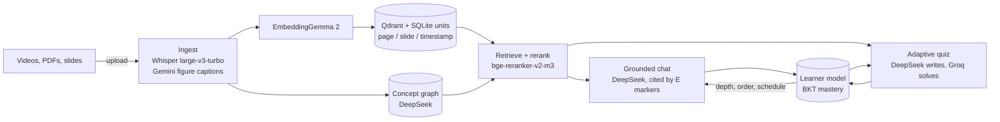
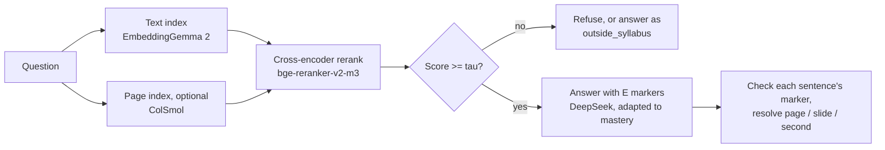
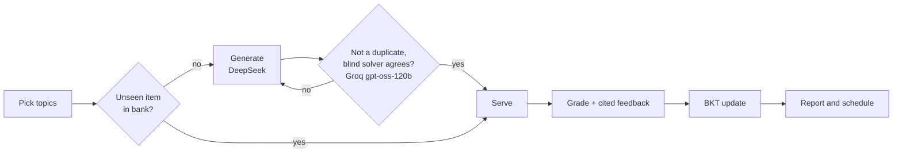
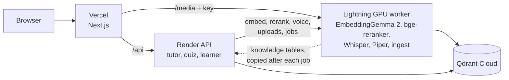

# Loopers — Multimodal AI Study Companion

Track D · Personalized Tutoring & Adaptive Learning · Multimodal AI Hackathon 2026

Loopers turns **lecture videos, textbooks and slide decks** into one source-cited knowledge base. A tutor answers
only from that material and cites the exact page, slide or video second. Quizzes are verified before they are
served, and a learner model tracks mastery per concept. The language model never writes a page number or
timestamp: it writes markers like `[E1]`, and the server resolves them from stored fields.

## Models

| Job | Model |
|---|---|
| Embeddings (text, figures, video clips) | `google/embeddinggemma-2` (gated: accept the license on Hugging Face) |
| Reranker and refusal gate | `BAAI/bge-reranker-v2-m3` cross-encoder |
| Page-image retrieval (optional, off by default) | `vidore/colSmol-500M` |
| Speech to text | faster-whisper `large-v3-turbo` on GPU, `base` on CPU |
| Text to speech | Piper `en_US-lessac-medium` |
| Tutor answers, concept graph, quiz generation | DeepSeek `deepseek-flash`, falling back to Groq `gpt-oss-120b`, then Gemini `3.5-flash-lite` |
| Blind quiz solver, answer checks | Groq `gpt-oss-120b`, then Gemini, then DeepSeek (never the generator first) |
| Figure captions | Gemini |
| Evaluation judge | Gemini `3.5-flash` / `flash-lite` and Groq `gpt-oss-120b` / `20b`; DeepEval cross-check on Groq. Never DeepSeek |
| Learner model | Bayesian knowledge tracing (no neural model) |

## How it works







Items can be MCQ, short answer or numeric, each tagged with topic, concept, difficulty and source location. Mastery
uses BKT (slip 0.10, guess 0.20, learn 0.05). New students take an intake question and a short IRT diagnostic.

## Run it

Copy the env file and fill in one LLM key (`DEEPSEEK_API_KEY` or `GEMINI_API_KEY`) and `HF_TOKEN`.

```bash
cp RAG_DB/.env.example RAG_DB/.env
```

**CPU** (give Docker 8 GB of memory; the first start downloads models):

```bash
docker compose -f docker-compose.app.yml --profile asr up -d --build
```

**NVIDIA GPU** (native Docker Engine with the NVIDIA Container Toolkit):

```bash
docker compose -f docker-compose.app.yml -f docker-compose.gpu.yml --profile asr up -d --build
```

UI at http://localhost:3000, API at http://localhost:8000 (`WEB_PORT` and `API_PORT` change them). Upload a PDF, deck
or video on the home page, wait for the job to reach `done`, then use chat, quizzes and the dashboard.

**Without Docker:**

```bash
cd RAG_DB && python src/pipeline.py ingest && python src/pipeline.py extract \
  && python src/pipeline.py label && python src/pipeline.py embed
cd src && LOOPERS_NO_REEXEC=1 uvicorn api.main:app   # no --reload: it orphans a running ingest job
# in another terminal:
cd frontend && npm run dev
```

**Deployed** (Vercel UI, Render API with no models, Lightning GPU worker behind ngrok):



Render sends model calls and uploads to the worker when `WORKER_URL` is set and copies the worker's knowledge tables
after each job and at boot. If the worker is down, chat answers `503 GPU worker offline`. A shared `WORKER_KEY`
protects every worker route except `/api/health`.

| Where | Variables |
|---|---|
| Lightning Studio (`python RAG_DB/scripts/lightning_serve.py`) | `NGROK_AUTHTOKEN`, `NGROK_DOMAIN`, `QDRANT_URL`, `QDRANT_API_KEY`, `DEEPSEEK_API_KEY`, `HF_TOKEN`, `WORKER_KEY` |
| Render | `WORKER_URL`, `WORKER_KEY`, `COLLECTION`, `QDRANT_URL`, `QDRANT_API_KEY`, LLM keys, `API_CORS_ORIGINS` |
| Vercel | `API_URL` (Render), `MEDIA_URL` (ngrok URL), `WORKER_KEY` |
| GitHub Actions variables | `RENDER_API_URL`, `WORKER_URL` (keep-alive pings) |

Seed the Studio with the demo course first (`RAG_DB/export_deploy_data.sh` builds `deploy_data/`). Render's free plan
resets students, mastery and chats on every deploy; knowledge comes back from the worker.

## Test it

```bash
cd RAG_DB && python -m pytest tests -q                                # backend
cd frontend && npm run typecheck && npm run lint && npx vitest run    # frontend
bash scripts/e2e_smoke.sh                                             # upload, chat, quiz on a running stack
RENDER_API_URL=<api> bash RAG_DB/scripts/e2e_worker.sh doc.pdf "a question it answers"   # deployed stack
```

Evaluation:

```bash
cd RAG_DB/src
python -m evaluation.run --k 5 --indexed-only          # retrieval + gate calibration
python -m evaluation.run --answers --limit N           # + faithfulness, relevancy, context P/R
python -m evaluation.simulate                          # simulated students
```

Don't run `evaluation.run` while the API is answering chats on a 6 GB GPU. To turn on page-image retrieval, start the
API with `LOOPERS_VISUAL_RETRIEVAL=1` and run `python -m ingest.page_embed`.

## Results (2026-10-13)

Demo course *Limits and Continuity*: OpenStax *Calculus Volume 1* ch. 2 (64 pages), MIT OCW 18.01 Lecture 2
(52 min) and a 12-slide deck. Run `ev_c7dd7ca45d` (`--answers --indexed-only`), 27 in-scope questions
(13 textbook, 8 video, 4 multi-hop, 2 Hindi) and 40 off-material questions, judged by Gemini Flash; simulation
`sim_3db7c2479d`, 20 students per profile over 10 sessions of 10 items:

| Metric | Value |
|---|---|
| Retrieval hit@5 / MRR | 0.93 / 0.89 |
| Refusal honesty / over-refusal | 1.00 / 0.07 |
| Faithfulness / answer relevancy | 0.75 / 0.99 |
| Context precision / recall | 0.87 / 0.81 |
| Citation accuracy | 0.57 |
| Mastery gain, adaptive vs control | 0.126 vs 0.115 (paired +0.011, SE 0.0008; adaptive better for 98% of students) |
| Question repetition, adaptive vs control | 0.001 vs 0.075 |

**Limits.** The golden set is generated and then spot-checked. The gate is calibrated on the same questions it is
scored on. The adaptive gain depends on a simulated student model. BKT drifts over sessions because it does not model
forgetting.

## Repo layout

```
RAG_DB/src/       pipeline modules + core/ api/ ingest/ concepts/ tutor/ assess/ learner/ revision/ evaluation/
RAG_DB/tests/     one small test file per package
frontend/         Next.js web app (/, /quiz, /report, /dashboard, /eval)
whisper-server/   local transcription
```
