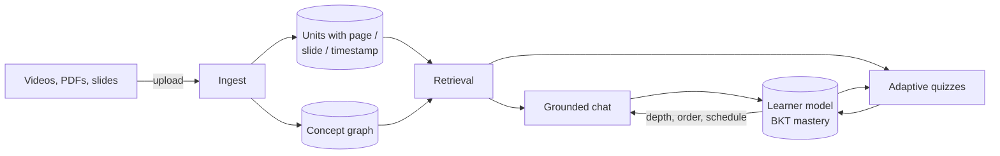
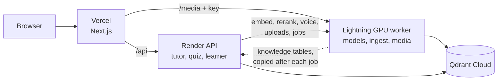
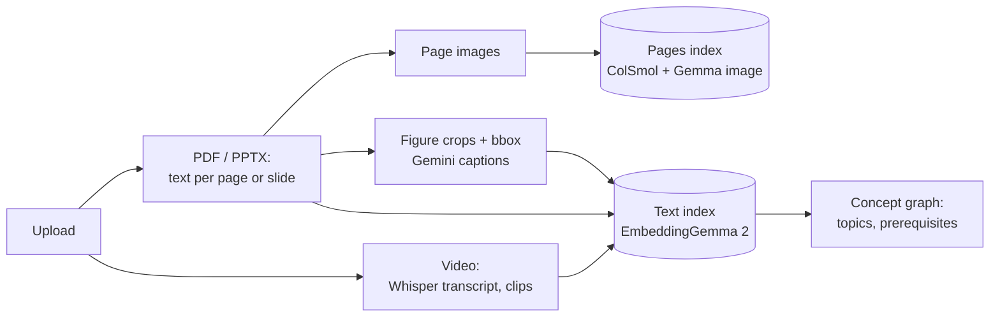
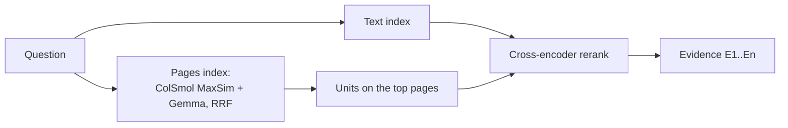
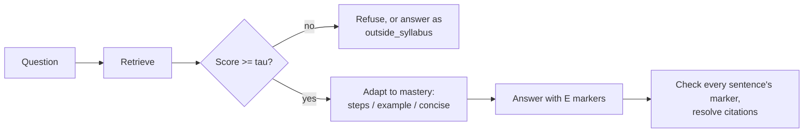
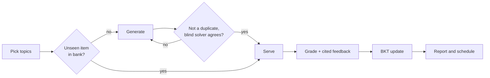

# Loopers — Multimodal AI Study Companion

Track D · Personalized Tutoring & Adaptive Learning · Multimodal AI Hackathon 2026

Loopers turns **lecture videos, textbooks and slide decks** into one source-cited knowledge base. A tutor answers
from that material only and cites the exact page, slide or video second. Quizzes are verified before they are
served, and a learner model tracks mastery per concept.

## How it works



The language model never writes a page number or timestamp. It writes markers like `[E1]`, and the server
resolves them from stored fields.

## Run it

Every mode starts from the same file. Copy it and fill in at least one LLM key (`DEEPSEEK_API_KEY` or
`GEMINI_API_KEY`) and `HF_TOKEN`. EmbeddingGemma 2 is a gated model, so the Hugging Face account behind the token
must have accepted its license on huggingface.co.

```bash
cp RAG_DB/.env.example RAG_DB/.env
```

**CPU, any machine.** Give Docker at least 8 GB of memory. The first start downloads the models into a volume.

```bash
docker compose -f docker-compose.app.yml --profile asr up -d --build
```

**NVIDIA GPU.** Needs the native Docker Engine with the NVIDIA Container Toolkit.

```bash
docker compose -f docker-compose.app.yml -f docker-compose.gpu.yml --profile asr up -d --build
```

The UI is at http://localhost:3000 and the API at http://localhost:8000. Change the ports with `WEB_PORT` and
`API_PORT`. Upload a PDF, deck or video on the home page and wait for the job to reach `done`; chat, quizzes and the
dashboard use whatever has been uploaded.

**Deployed.** The site is split in three. Vercel serves `frontend/`. Render runs the API (tutor, quizzes, learner
model) from `Dockerfile.render` with no models in it. A Lightning Studio with a GPU runs the same code as a worker
(`RAG_DB/scripts/lightning_serve.py`, exposed through an ngrok domain) and does the heavy work.



Render sends embedding, reranking, speech and upload calls to the worker when `WORKER_URL` is set. When the job
finishes, Render copies the worker's knowledge tables (sources, units, concepts) into its own SQLite, and again at
boot. If the worker is down, chat answers `503 GPU worker offline` and never answers without retrieval. A shared
`WORKER_KEY` protects every worker route except `/api/health`.

| Where | Variables |
|---|---|
| Lightning Studio | `NGROK_AUTHTOKEN`, `NGROK_DOMAIN`, `QDRANT_URL`, `QDRANT_API_KEY`, `DEEPSEEK_API_KEY`, `HF_TOKEN`, `WORKER_KEY` |
| Render | `WORKER_URL` (the ngrok URL), `WORKER_KEY`, `COLLECTION`, `QDRANT_URL`, `QDRANT_API_KEY`, LLM keys, `API_CORS_ORIGINS` (the Vercel origin) |
| Vercel | `API_URL` (Render), `MEDIA_URL` (the ngrok URL), `WORKER_KEY` |
| GitHub Actions variables | `RENDER_API_URL`, `WORKER_URL` (keep-alive pings) |

Before the first upload, copy the demo course into the Studio (`RAG_DB/export_deploy_data.sh` builds
`deploy_data/`), so the concept rebuild sees the whole course. Render's free plan keeps students, mastery, quizzes and
chats on an ephemeral disk, so they reset on every deploy; the knowledge tables come back from the worker at boot.
`RENDER_API_URL=<api> bash RAG_DB/scripts/e2e_worker.sh doc.pdf "a question it answers"` uploads through Render, waits
for the GPU job and asks one question.

To run without Docker:

```bash
cd RAG_DB && python src/pipeline.py ingest && python src/pipeline.py extract \
  && python src/pipeline.py label && python src/pipeline.py embed
cd src && LOOPERS_NO_REEXEC=1 uvicorn api.main:app   # no --reload: it orphans a running ingest job
cd frontend && npm run dev
```

On a 6 GB card, Whisper runs on the CPU by default, and the reranker and ColSmol move onto the GPU only while
they score. Don't run `evaluation.run` while the API is answering chats.

## Ingestion



Every unit stores its locator: `page_no` for PDFs, `slide_no` for decks, `t_start` for video. Ingestion fails if a
PDF chunk has none. `python src/pipeline.py concepts` builds the concept graph with an LLM and tags each unit with
its concepts.

## Retrieval



The page leg finds pages by how they look, which catches plots, tables and equations that text extraction misses.
It is off by default. To turn it on and index the rendered pages:

```bash
LOOPERS_VISUAL_RETRIEVAL=1 docker compose -f docker-compose.app.yml -f docker-compose.gpu.yml up -d --build api
docker compose -f docker-compose.app.yml exec api sh -c "cd src && python -m ingest.page_embed"
```

On the demo course (27 questions) it raises hit@5 from 0.93 to 0.96 and MRR from 0.89 to 0.93. The whole gain
is one more text question found. Use `COLPALI_MODEL` to swap the model on a bigger GPU.

## Tutor chat



Citations open the page image with its box, the slide, or the video at the cited second. Sessions are stored in
SQLite.

## Quizzes and the learner model



Items can be MCQ, short answer or numeric, and each is tagged with its topic, concept, difficulty and source
location. Mastery uses Bayesian knowledge tracing (slip 0.10, guess 0.20, learn 0.05). New students take an intake
question and a short IRT diagnostic. The schedule puts weak concepts first and unlocks a concept once its
prerequisites reach 0.70.

## Web app

| Page | Shows |
|---|---|
| `/` | Tutor chat, course map, uploads |
| `/quiz` | Practice quiz or timed mock exam |
| `/report` | Score, mastery change, weak topics, misconceptions |
| `/dashboard` | Mastery heatmap, flashcards, audio brief, schedule |
| `/eval` | Latest evaluation runs |

## Evaluation

```bash
cd RAG_DB/src
python -m evaluation.run --k 5 --indexed-only          # retrieval + gate calibration
python -m evaluation.run --answers --limit N           # + faithfulness, relevancy, context P/R
python -m evaluation.simulate                          # simulated students
```

The judge is a different model from the generator, and a DeepEval cross-check runs on dumped samples. Tests:
`cd RAG_DB && python -m pytest tests -q`. End to end: `scripts/e2e_smoke.sh`.

## Results (2026-10-13)

Demo course *Limits and Continuity*: OpenStax *Calculus Volume 1* ch. 2 (64 pages), MIT OCW 18.01 Lecture 2
(52 min) and a 12-slide deck. Run `ev_c7dd7ca45d` (`--answers --indexed-only`), with 27 in-scope questions
(13 textbook, 8 video, 4 multi-hop, 2 Hindi) and 40 off-material questions, judged by Gemini Flash; simulation
run `sim_3db7c2479d`, 20 students per profile over 10 sessions of 10 items:

| Metric | Value |
|---|---|
| Retrieval hit@5 / MRR | 0.93 / 0.89 |
| Refusal honesty / over-refusal | 1.00 / 0.07 |
| Faithfulness / answer relevancy | 0.75 / 0.99 |
| Context precision / recall | 0.87 / 0.81 |
| Citation accuracy | 0.57 |
| Mastery gain, adaptive vs control | 0.126 vs 0.115 (paired +0.011, SE 0.0008; adaptive better for 98% of students) |
| Question repetition, adaptive vs control | 0.001 vs 0.075 |

**Limits.**

- The golden set is generated and then spot-checked.
- The gate is calibrated on the same questions it is scored on.
- The adaptive gain depends on a simulated student model.
- BKT drifts over sessions because it does not model forgetting.

## Repo layout

```
RAG_DB/src/       pipeline modules + core/ api/ ingest/ concepts/ tutor/ assess/ learner/ revision/ evaluation/
RAG_DB/tests/     one small test file per package
frontend/         Next.js web app
whisper-server/   local transcription
```
